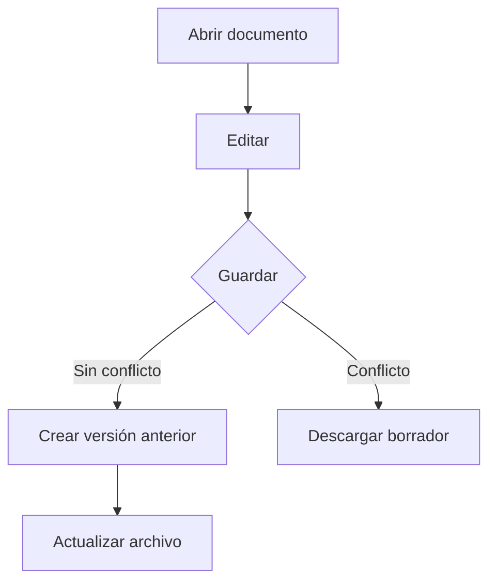

# Documento de prueba

Este documento incluye **negrita**, *cursiva*, ~~tachado~~ y `código`.

## Tabla

| Función | Estado |
| --- | --- |
| Guardar | Disponible |
| Borrar y restaurar | Disponible |

## Lista de tareas

- [x] Abrir documento
- [ ] Guardar una copia
- [ ] Probar la papelera

## Código

```python
def saludar(nombre):
    return f"Hola, {nombre}"
```

## Matemáticas

En línea: $E = mc^2$.

$$
\int_0^1 x^2\,dx = \frac{1}{3}
$$

## Diagrama



## Nota al pie

Ejemplo con una nota[^1].

[^1]: El documento original se conserva al editar.

<details>
<summary>Mostrar información adicional</summary>
<p>Este HTML básico se admite y se sanea.</p>
</details>

> Prueba los botones de formato seleccionando texto en el editor.
